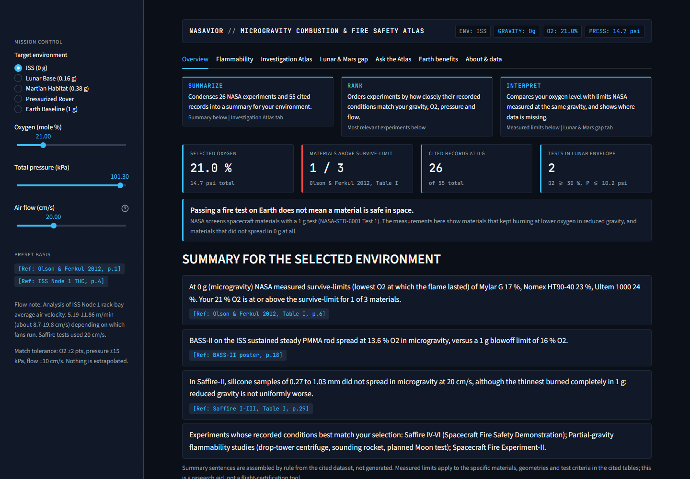
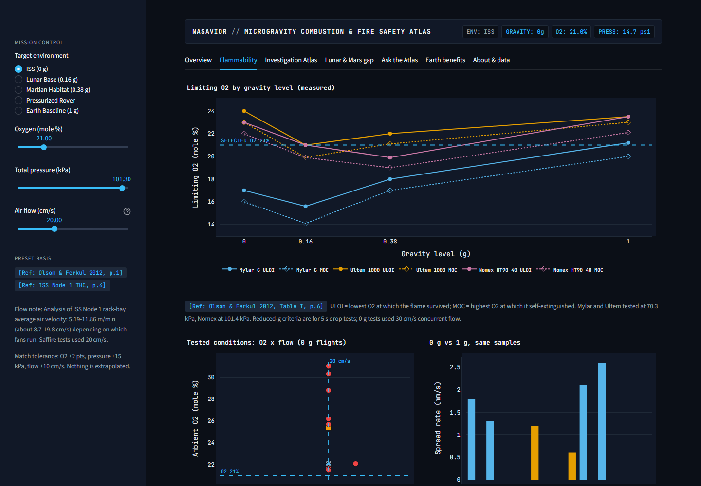
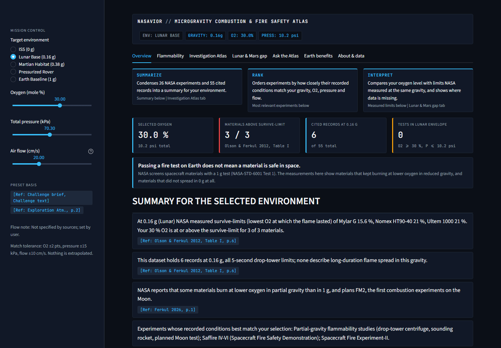
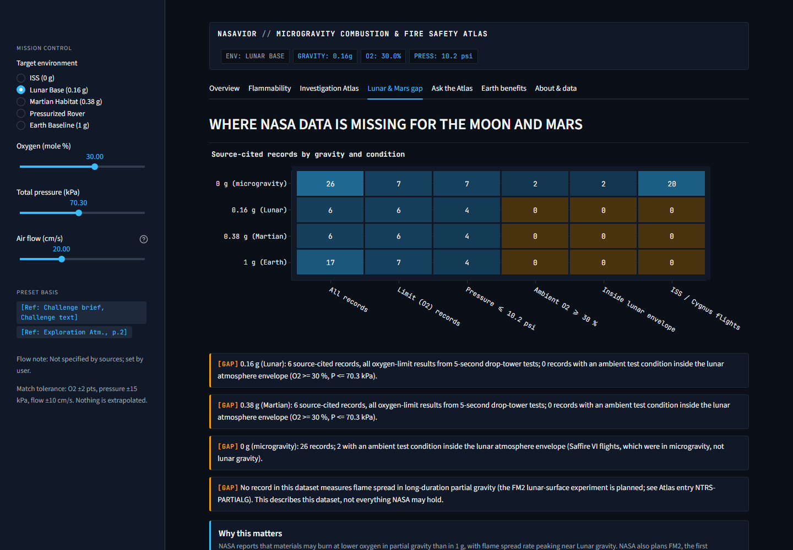
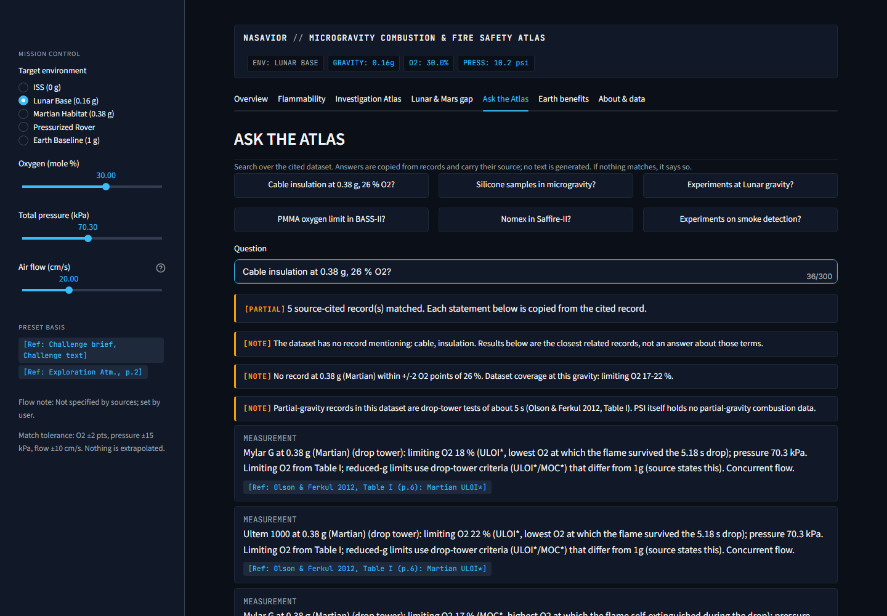

# Nasavior

**Microgravity Combustion & Fire Safety Atlas** for the NASA International Space Apps Challenge 2026, challenge *Flame in Freefall*.

Nasavior lets an engineer pick a target environment (ISS, Lunar base, Martian habitat, pressurized rover, Earth baseline), set oxygen, pressure and air flow, and see what NASA has actually measured: which experiments are relevant, where a material burned in 0 g but not in 1 g (or the reverse), and where NASA has no data at all, especially for the Moon and Mars.

> Passing a fire test on Earth does not mean a material is safe in space.

**Live app:** https://nasavior.streamlit.app  
**Repository:** https://github.com/muhammedesatdemir/nasavior

Every number on screen is transcribed from a NASA document and shown with its reference and page. Nothing is estimated, interpolated or generated.

## How it answers the challenge

The challenge asks for a tool that **summarizes, ranks and interprets** NASA combustion experiments. All three are on the first screen.

| Challenge asks | Where in Nasavior |
|---|---|
| Summarize | "Summary for the selected environment" on Overview: rule-assembled sentences, each with its source; Atlas of 26 experiments with objectives and cited findings |
| Rank | "Most relevant experiments": ordered by how many cited records match the selected gravity, O2, pressure and flow, with the reasons shown |
| Interpret | "Measured limits at the selected gravity" (your O2 against NASA's measured limits), 0 g vs 1 g comparison, oxygen margin of safety, and the Moon/Mars data-gap analysis |
| Find experiments for a station, Moon base, Mars habitat or pressurized rover | Environment selector with five presets and their sources |
| Highlight research for next-generation fire equipment | Atlas themes (material flammability, smoke detection, suppression) and the equipment column |
| Terrestrial applications | "Earth benefits" tab, copied from PSI |







## What it shows

| Tab | Content |
|---|---|
| Overview | Measured oxygen limits at the selected gravity, ranked relevant experiments, oxygen margin of safety versus 1 g |
| Flammability | Limiting O2 by gravity level, an O2 x flow map of every tested condition, 0 g vs 1 g sample comparison |
| Investigation Atlas | 26 experiments (24 NASA PSI records and 2 NTRS entries) with objectives, hardware, cited findings and PSI links |
| Lunar & Mars gap | Coverage matrix of source-cited records; where the data stops |
| Ask the Atlas | Search over the cited dataset. Answers are copied from records with their source; if nothing matches it says so |
| Earth benefits | NASA PSI's own "Research Impacts / Earth Benefits" texts |
| About & data | Method, known limitations, full reference list |

## Findings the data supports

- **PMMA rod (BASS-II, ISS):** steady spread at 13.6 % O2 in 0 g, while the 1 g blowoff limit is 16 % O2, a negative margin of 2.4 % O2 (BASS-II poster, p.18).
- **Silicone (Saffire-II):** none of the 0.27 to 1.03 mm samples spread in 0 g at 20 cm/s, although the thinnest burned completely in 1 g. Reduced gravity is not always worse (Saffire I-III, Table I).
- **Reduced-gravity oxygen margins** for Mylar, Ultem and Nomex are negative at Martian, Lunar and 0 g in drop-tower tests, so the 1 g screening limit was not conservative for them (Olson & Ferkul 2012, Table I).
- **Partial gravity is the gap:** all 0.16 g and 0.38 g records are 5 s drop-tower tests, none lies inside the lunar atmosphere envelope (O2 >= 30 %, <= 10.2 psi), and PSI holds no partial-gravity combustion data.

## Run it

Developed and tested on Python 3.13. Use a currently supported Python version when deploying. The app needs no API key, no network access at run time and no secrets.

```bash
git clone https://github.com/muhammedesatdemir/nasavior.git
cd nasavior
python -m venv .venv
.venv\Scripts\activate          # Windows;  source .venv/bin/activate on macOS/Linux
pip install -r requirements.txt
streamlit run app.py
```

Run the checks:

```bash
pip install -r requirements-dev.txt
python scripts/validate_data.py   # schema, reference integrity, null policy
python -m pytest -q               # 94 tests: data, engine, Q&A, edge cases, design, deploy readiness, app smoke tests
```

### Deploy (Streamlit Community Cloud)

1. Push the repository to GitHub (public).
2. On share.streamlit.io choose the repository, branch `main` and main file `app.py`, and pick Python 3.13 (the version tested here) in the advanced settings.
3. No secrets are needed: the app uses no external API.

## Data honesty

All values were transcribed by hand from the documents in [data/references.json](data/references.json). Fields a source does not state are empty. Details, scripts and known limitations are in [data/PROVENANCE.md](data/PROVENANCE.md).

| Principle | How it is enforced |
|---|---|
| Every number is cited | `scripts/validate_data.py` rejects any record without `ref_id` and `page_or_figure` |
| No extrapolation | A limit is shown only for the gravity level where it was measured; tests assert this |
| No invented answers | Ask the Atlas retrieves records (BM25) and never writes text; unknown terms and empty matches are reported |
| Assumptions are visible | Mars habitat and rover atmospheres are flagged as assumptions in the interface |
| Sources can be audited | Raw PSI dump and extraction scripts are in the repository |

### Known limitations

- Reduced-gravity limits (0.16 g, 0.38 g) come only from drop-tower tests (5.18 s) with criteria that differ from 1 g, as stated by the source.
- Saffire I-III Table I gives no pressure; the field is left empty.
- Saffire VI per-sample heat release, CO and CO2 columns were garbled in text extraction and are not used.
- PSI investigation links follow the PSI web-app route and were not browser-tested.
- Relevance ranking is a search aid, not a hazard score.
- Olson & Ferkul 2012 contradicts itself between its Conclusions and Table I about the largest Martian margin; Table I is used.
- 20 of the 26 Atlas entries show the PSI objective text only; no quantitative findings were extracted for them.

## Architecture

```
app.py                      Streamlit entry point
src/models.py               Pydantic models and loaders
src/engine.py               Same-gravity limit margins, relevance ranking, 0 g vs 1 g pairs, coverage gaps
src/qa.py                   BM25 retrieval, citation-bound answers, missing-term detection
src/ui/theme.py             Design tokens, CSS, citation pills, KPI cards
src/ui/charts.py            Plotly figures
data/                       investigations.json, measurements.csv, references.json, environments.yaml, PROVENANCE.md
data/raw/                   PSI metadata dump and extracted source text
scripts/                    fetch_psi.py, build_investigations.py, build_measurements.py, validate_data.py
tests/                      data, engine, Q&A, robustness, design and app tests
docs/submission.md          Text for the Space Apps project page
```

## Data sources

- NASA Physical Sciences Informatics (PSI): investigation metadata, public API behind psi.nasa.gov.
- NASA Technical Reports Server (NTRS): BASS-II poster (20160000593), Olson & Ferkul 2012 (20130010991), Marcum et al. 2016 (20160012691), Ferkul et al. 2026 (20260000646), LUCI 2025 (20250010653), Saffire I-III (20170008805), Saffire IV-V (20210011521), Saffire VI (20240002981), ISS Node 1 THC (20070018272), Exploration Atmospheres (20220011152).
- Space Apps challenge brief: lunar atmosphere envelope.

## Use of AI

Code was written with the help of an AI coding assistant (Claude Code). The idea, the data selection, the source extraction checks and the design decisions are the team's. The application itself contains no generative model: search is BM25 over cited records. See [docs/submission.md](docs/submission.md).

## Team

- **Muhammed Esat Demir**, Software & Product Lead: application, interface, deployment.
- **Kevser Demir**, Data & Science Lead: NASA source review, data extraction and verification.

## License

MIT, see [LICENSE](LICENSE). NASA documents remain subject to their own terms of use.
